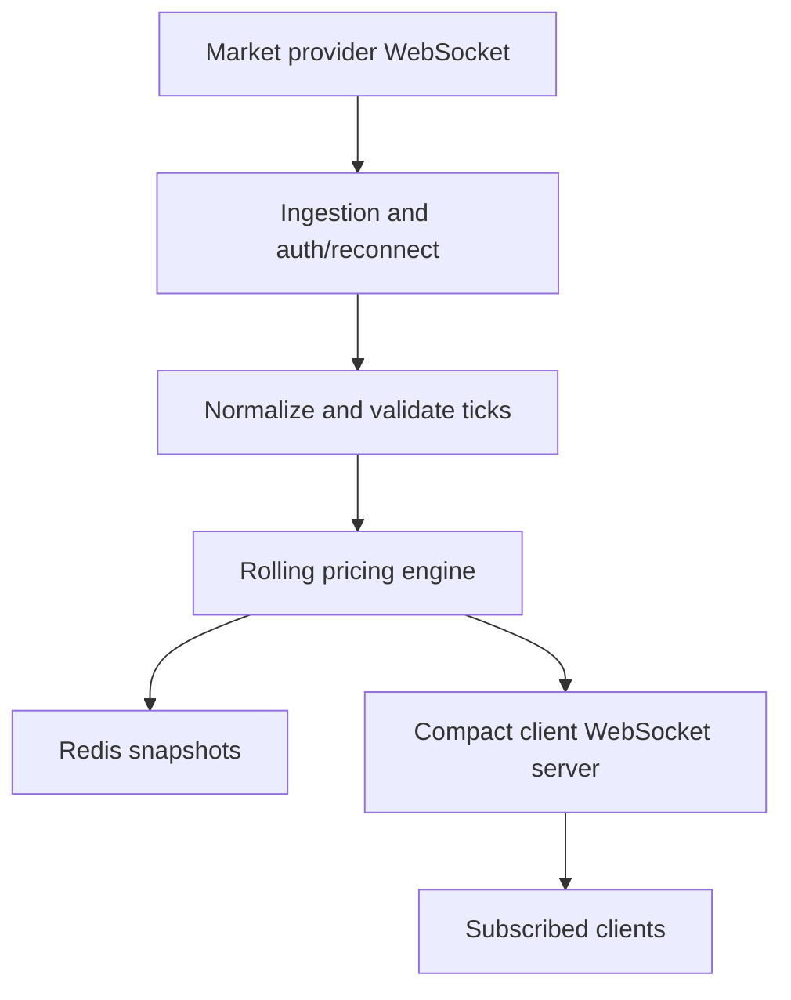

# Real-Time Pricing Engine

A TypeScript/Node.js starter implementation for the supplied market-data assignment. It connects to an upstream WebSocket, authenticates, subscribes to the requested symbols, computes rolling 24-hour statistics, persists state in Redis, and broadcasts compact updates to subscribed clients.

> **Important:** the provider's exact authentication response and tick payload schema were not included in the assignment PDF. The code uses a defensive parser for direct, array, and common nested (`data`, `prices`, `result`, or `payload`) envelopes, but you must verify `src/upstream.ts` and `src/normalizer.ts` against actual provider messages. Do not claim live-feed success until you see authenticated/subscribed logs and recognized ticks.

## Requirements

- Node.js 22 LTS (Node 20+ should also work)
- Redis 7 or compatible Redis server
- Provider-issued API credentials
- Docker is not required for local development

## Run locally on Windows

1. Install Node.js and Redis (or use a compatible local Redis service).
2. Copy `.env.example` to `.env`.
3. Put your newly rotated provider credentials in `.env`. Never commit `.env`.
4. Start Redis and verify `redis-cli ping` returns `PONG`.
5. In this directory, run:

   ```bash
   npm install
   npm run dev
   ```

6. Check `http://localhost:8080/health` and `http://localhost:8080/prices`.
7. Connect a WebSocket client to `ws://localhost:8080` and send:

   ```json
   { "action": "subscribe", "symbols": ["EURUSD", "BTCUSD"] }
   ```

   The server immediately sends any available current snapshots for the requested symbols, followed by live updates. Updates use compact keys: `s` symbol, `b` buy, `a` sell, `h` 24-hour high, `l` 24-hour low, `c` 24-hour change percent, `t` timestamp in milliseconds.

## Tests and build

```bash
npm test
npm run typecheck
npm run build
npm start
```

## Docker Compose (required by assignment)

After `.env` is configured and Docker Desktop is installed:

```bash
docker compose up --build
```

Stop services with `docker compose down`. Redis data is stored in a named volume. `docker compose down -v` also deletes that volume.

## HTTP endpoints

- `GET /health` — process health, Redis availability, and symbol count
- `GET /prices` — current snapshots for known symbols
- `GET /prices/:symbol` — current snapshot for one symbol
- `ws://localhost:8080` — client WebSocket server

## Calculation decisions

- Buy and sell are the latest accepted tick values.
- Mid-price is `(buy + sell) / 2`.
- High and low are computed from mid-price samples in the trailing 24-hour window.
- Percentage change compares the latest mid-price with the earliest retained sample inside the rolling window. This is an explicit MVP convention; align it with the evaluator's expected baseline if they specify one.
- Incoming `low_24h`, `high_24h`, and `change_24h` fields are ignored.
- Same-symbol ticks with an identical timestamp are treated as duplicates.
- Out-of-order samples are inserted in timestamp order.

## Known limitations / production hardening

1. **Provider schema needs confirmation.** Authentication success/failure detection is intentionally tolerant but may need adjustment. Inspect sanitized provider messages and adapt the parser. Never log credentials.
2. **Performance target is not yet proven.** This MVP recalculates statistics by scanning the rolling sample window. For high-frequency feeds, replace it with monotonic deques or indexed time-series structures and benchmark under realistic load.
3. **Snapshot persistence is periodic.** A crash can lose ticks since the last snapshot. Use a durable event log or more frequent/atomic persistence if the recovery-point objective requires it.
4. **Redis state size can grow.** For production, cap sample retention based on observed tick frequency, compress history, or persist compact rolling structures.
5. **24-hour change baseline.** If there is no sample near the 24-hour cutoff, this implementation uses the earliest available in-window sample. Report missing/insufficient history explicitly in a production API.
6. **Out-of-order ticks and latest values.** Historical samples are sorted; latest buy/sell only advance for newer timestamps. Equal timestamps are deduplicated.
7. **Price-spike handling.** Invalid, non-positive and extremely stale/future timestamps are rejected. Statistical spike filtering is deliberately not automatic because legitimate market moves must not be silently discarded.
8. **Payload optimization.** The output is compact JSON and WebSocket compression is enabled. The `<10KB` requirement should be validated against actual client batch size and measured with a script; a single tick should be much smaller than that target.
9. **Authentication and client access.** Add client authentication, per-client subscription limits, rate limiting, TLS termination, structured metrics, and graceful health/readiness probes before production use.

## Architecture



## Deliverables checklist

- [x] Source code organized into modules
- [x] Redis persistence and state restoration
- [x] Upstream reconnect with exponential backoff and jitter
- [x] Compact WebSocket output and symbol subscriptions
- [x] Unit tests for basic rolling state behavior
- [x] Dockerfile and Docker Compose
- [ ] Verify upstream authentication response and payload with real credentials
- [ ] Benchmark latency and throughput with actual market feed
- [ ] Add measured performance results and challenges to submission
